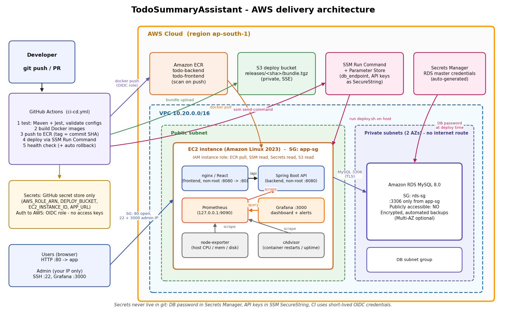

# AWS setup (EC2 + RDS + IAM + networking)



Everything below is also codified in [`aws/iac/`](iac/) (Terraform / OpenTofu). The manual steps are
documented so the design can be reviewed and reproduced without Terraform.

> **Region / sizing assumptions** - `ap-south-1`, one EC2 `t3.small` (2 GiB; `t3.micro` works with the
> bundled 2 GiB swap but is tight with Prometheus + Grafana + cAdvisor), RDS `db.t3.micro`, 20 GiB gp3,
> single-AZ. No domain name, so the app is plain HTTP on port 80 (see *Hardening / next steps*).

## 1. Networking

| Resource | Setting |
|---|---|
| VPC | `10.20.0.0/16`, DNS support + hostnames on |
| Public subnet (AZ a) | `10.20.0.0/24`, route `0.0.0.0/0 -> Internet Gateway`. Holds the EC2 instance |
| Private subnets (AZ a + b) | `10.20.10.0/24`, `10.20.11.0/24`, route table with **no** internet route. Hold RDS (a DB subnet group needs 2 AZs) |
| Elastic IP | attached to the EC2 instance so the URL survives stop/start |

No NAT gateway is used (cost). RDS needs no outbound internet access.

## 2. Security groups

| SG | Direction | Port | Source | Why |
|---|---|---|---|---|
| `app-sg` (EC2) | in | 80/tcp | `0.0.0.0/0` | the application (nginx) |
| | in | 3000/tcp | **admin IP /32** | Grafana |
| | in | 22/tcp | **admin IP /32** (optional) | SSH. Not needed: deployments and shell use SSM |
| | out | all | anywhere | pull images, SSM, S3, Cohere, Slack |
| `rds-sg` | in | 3306/tcp | **`app-sg` only** (SG reference, not CIDR) | MySQL |
| | out | none | | |

Not exposed to the internet: backend `:8080` (only on the Docker network), Prometheus `:9090`
(bound to `127.0.0.1`), node-exporter, cAdvisor and the database. RDS has `publicly_accessible = false`
and sits in subnets without an internet route.

## 3. IAM (least privilege, no static keys)

**EC2 instance role `todoapp-ec2-role`** (instance profile; IMDSv2 required, hop-limit 1 so containers
cannot read the credentials)

* `AmazonSSMManagedInstanceCore` - Session Manager and Run Command
* `ecr:GetAuthorizationToken`, and **pull-only** ECR actions on the two repositories
* `ssm:GetParameter(s)` on `/todoapp/prod/*` only
* `secretsmanager:GetSecretValue` on the single RDS secret
* `s3:GetObject` on `releases/*` of the deploy bucket

**GitHub Actions role `todoapp-github-deploy`** (assumed through OIDC, trust restricted to
`repo:<owner>/<repo>:ref:refs/heads/main` and the `production` environment)

* ECR push actions on the two repositories only
* `s3:PutObject` on `releases/*`
* `ssm:SendCommand` only on the `AWS-RunShellScript` document and only on **this** instance
* `ssm:GetCommandInvocation`

No IAM user, no access key, nothing long-lived is stored in GitHub or on the instance.

## 4. Secrets and configuration

| Value | Where it lives | Who reads it |
|---|---|---|
| RDS master password | AWS Secrets Manager, generated and rotated by RDS (`manage_master_user_password`) | EC2 role, at deploy time |
| `COHERE_API_KEY`, `SLACK_WEBHOOK_URL`, Grafana admin password | SSM Parameter Store `SecureString` under `/todoapp/prod/` | EC2 role, at deploy time |
| DB endpoint / name / secret ARN | SSM Parameter Store `String` | EC2 role |
| `AWS_ROLE_ARN`, `DEPLOY_BUCKET`, `EC2_INSTANCE_ID`, `APP_URL` | GitHub repository secrets | pipeline |

`scripts/deploy.sh` reads these on the instance, exports them into the process environment of
`docker compose up`, and never writes them to disk or to a file in the repo.

## 5. Provisioning with Terraform

```bash
cd aws/iac
cp terraform.tfvars.example terraform.tfvars   # set admin_cidr and github_repository
terraform init
terraform plan
terraform apply
```

Outputs give the values for the GitHub secrets. Then set the real secrets **out of band** (they are
created as `REPLACE_ME` placeholders so they never enter Terraform state):

```bash
R=ap-south-1
aws ssm put-parameter --region $R --overwrite --type SecureString --name /todoapp/prod/cohere_api_key        --value '<cohere key>'
aws ssm put-parameter --region $R --overwrite --type SecureString --name /todoapp/prod/slack_webhook_url     --value '<slack webhook>'
aws ssm put-parameter --region $R --overwrite --type SecureString --name /todoapp/prod/grafana_admin_password --value '<strong password>'
```

Add the repository secrets `AWS_ROLE_ARN`, `DEPLOY_BUCKET`, `EC2_INSTANCE_ID`, `APP_URL`
(Settings -> Secrets and variables -> Actions), optionally the variable `AWS_REGION`, and create a
GitHub *Environment* named `production` (leave "required reviewers" **off** - deployments must have
no manual step). Push to `main`: the pipeline builds, pushes to ECR and deploys.

## 6. Manual equivalent (console / CLI) in short

1. VPC + subnets + IGW + route tables as in section 1.
2. Two security groups as in section 2 (RDS source = the app SG id).
3. RDS MySQL 8.0, `db.t3.micro`, subnet group of the private subnets, *Public access: No*, attach `rds-sg`,
   *Manage master credentials in Secrets Manager*, backups 7 days.
4. IAM role + instance profile from section 3; launch Amazon Linux 2023 in the public subnet with
   `scripts/ec2-user-data.sh` as user data; associate an Elastic IP.
5. Create the ECR repositories `todo-backend`, `todo-frontend`; the S3 bucket; the SSM parameters.
6. Create the GitHub OIDC provider and the deploy role.

## 7. Verifying the setup

```bash
# RDS is private and not reachable from the internet
aws rds describe-db-instances --query 'DBInstances[0].PubliclyAccessible'        # false
# RDS ingress rule references the EC2 SG, not a CIDR
aws ec2 describe-security-groups --filters Name=group-name,Values=todoapp-rds-sg \
  --query 'SecurityGroups[0].IpPermissions'
# App + health
curl -fsS http://<EIP>/healthz            # {"status":"UP"}
# Shell without SSH
aws ssm start-session --target <instance-id>
# Reach Prometheus (loopback only) from your laptop
aws ssm start-session --target <instance-id> --document-name AWS-StartPortForwardingSession \
  --parameters '{"portNumber":["9090"],"localPortNumber":["9090"]}'
```

## 8. Cost control

Stop/destroy after the review: `terraform destroy` (deletes EC2, EIP, RDS without a final snapshot,
ECR repos and the bucket - `deletion_protection` is off for the assessment).

## 9. Hardening / next steps (out of scope)

HTTPS (ALB + ACM or Caddy with a domain), Multi-AZ RDS (`db_multi_az = true`), AWS WAF, a second
instance behind an ALB, CloudWatch agent for logs, VPC endpoints instead of internet egress, signed
images (cosign) and pinning GitHub Actions by commit SHA.
